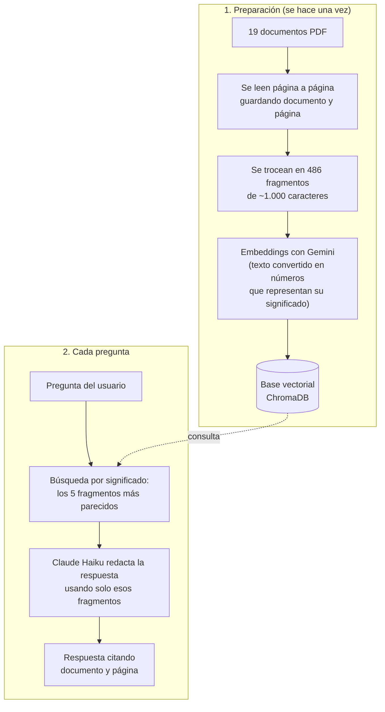

# 🚚 Asistente RAG para Transportes RAG S.L.

Asistente con inteligencia artificial que responde preguntas sobre los documentos internos de una empresa logística **citando el documento y la página** de donde saca cada dato.

**👉 Pruébalo aquí: [transportes-rag.streamlit.app](https://transportes-rag.streamlit.app)**

> ⚠️ **Aviso:** Transportes RAG S.L. es una **empresa ficticia**. Sus documentos, datos, precios, personas y direcciones son **inventados** para este proyecto de portfolio. La única excepción es la normativa pública descargada del BOE.

---

## ¿Qué hace?

Le preguntas en lenguaje natural y responde usando solo los documentos de la empresa:

> **Pregunta:** ¿Cuánto cuesta enviar dos palets a Baleares?
>
> **Respuesta:** Enviar dos palets a Islas Baleares (Zona 4) cuesta **520,00 € sin IVA**.
> - Precio por palet en Zona 4: 260,00 € [06_tarifas_transporte_2026.pdf, página 2]
> - Cálculo: 2 × 260,00 € = 520,00 €
> - Con IVA del 21 %: 629,20 € [06_tarifas_transporte_2026.pdf, página 1]

Si la respuesta no está en los documentos, lo dice en lugar de inventarla:

> **Pregunta:** ¿Quién ganó el Mundial de fútbol de 2022?
>
> **Respuesta:** No encuentro esa información en los documentos de la empresa.

---

## ¿Cómo funciona?

El proyecto usa la técnica **RAG** (*Retrieval-Augmented Generation*, generación aumentada por recuperación): antes de responder, la IA busca en los documentos de la empresa y redacta la respuesta solo con lo que encuentra.



---

## Tecnologías

| Herramienta | Para qué se usa |
| --- | --- |
| **Python 3.13** | Lenguaje del proyecto |
| **LangChain** | Conecta las piezas del RAG y permite cambiar de proveedor de IA cambiando una línea |
| **ChromaDB** | Base de datos vectorial donde se guardan los fragmentos |
| **Gemini (Google)** | Embeddings: convierte los textos en vectores para buscarlos por significado |
| **Claude Haiku (Anthropic)** | Redacta las respuestas a partir de los fragmentos encontrados |
| **Streamlit** | Interfaz web tipo chat |
| **Streamlit Community Cloud** | Publicación gratuita de la web |
| **Git y GitHub** | Control de versiones |

---

## Documentos

**19 documentos PDF (124 páginas):**

- **14 documentos inventados** de la empresa: manual de almacén, protocolo de recepción de mercancía, política de devoluciones, procedimiento de carretillas elevadoras, preguntas frecuentes de clientes, tarifas 2026, plazos de entrega y zonas, protocolo de mercancía dañada e incidencias, normas de picking y packing, política de mercancías peligrosas, manual de bienvenida, turnos y vacaciones, procedimiento de inventario y condiciones generales de contratación.
- **5 normas públicas del BOE**: Ley 31/1995 de Prevención de Riesgos Laborales y los Reales Decretos 486/1997 (lugares de trabajo), 487/1997 (manipulación manual de cargas), 773/1997 (equipos de protección individual) y 1215/1997 (equipos de trabajo). Se descargan automáticamente con `descargar_normativa.py`.

Los documentos inventados están relacionados entre sí y contienen datos concretos (precios, plazos, horarios), para poder comprobar si las respuestas son exactas.

---

## Evaluación

Para medir la calidad sin depender de pruebas a mano, el script `evaluar.py` hace un examen automático con **20 preguntas que tienen su respuesta correcta** (`evaluacion/preguntas.csv`). Incluye cálculos, preguntas formuladas de forma distinta al documento y **preguntas trampa** cuya respuesta no está en los documentos.

Mide dos cosas por separado, para saber dónde falla el sistema si algo sale mal:

| Métrica | Qué comprueba | Resultado |
| --- | --- | --- |
| **Búsqueda** | ¿Encontró el documento correcto entre los 5 fragmentos? | **18/18 (100 %)** |
| **Respuesta** | ¿La respuesta final es correcta? | **20/20 (100 %)** |

La corrección de las respuestas se valora con la técnica **"IA como juez"**: otra llamada al modelo compara la respuesta del asistente con la respuesta correcta.

> Un 100 % con 20 preguntas no significa que el sistema sea perfecto: es un conjunto pequeño, escrito por el mismo autor de los documentos. El siguiente paso sería ampliarlo con preguntas de usuarios reales.

El detalle de cada pregunta queda guardado en `evaluacion/resultados.csv`.

---

## Decisiones técnicas

- **Citar la fuente:** cada fragmento guarda el nombre del documento y la página, y las instrucciones obligan a la IA a citarlos después de cada dato. Así se puede comprobar cualquier respuesta.
- **Evitar inventos (alucinaciones):** la IA tiene la instrucción de responder solo con los fragmentos y decir "No encuentro esa información" cuando no esté. La búsqueda siempre devuelve 5 fragmentos aunque no tengan relación con la pregunta, así que esta regla es imprescindible.
- **Fragmentos de ~1.000 caracteres con 150 de solapamiento:** suficientemente pequeños para pasar a la IA solo lo relevante y con solapamiento para no cortar una idea por la mitad.
- **Cambio de Gemini a Claude para las respuestas:** la capa gratuita de Gemini limita a 20 preguntas al día, insuficiente para una web pública y para evaluar. Gracias a LangChain, el cambio fue de una línea. Los embeddings siguen en Gemini, que sí tiene cupo gratuito suficiente.
- **Base vectorial incluida en el repositorio:** así la web publicada arranca sin tener que regenerarla (unos 7 minutos y consumo de cuota).
- **Claves secretas fuera del código:** en local se guardan en un archivo `.env` excluido de Git y en la web publicada, en los *Secrets* de Streamlit.
- **Lógica separada de la interfaz:** `rag.py` contiene el "cerebro" y lo usan tanto la web (`app.py`) como la evaluación (`evaluar.py`).

---

## Estructura del proyecto

```
transportes-rag/
├── app.py                     # Interfaz web con Streamlit
├── rag.py                     # Lógica RAG: búsqueda + respuesta con citas
├── crear_base_vectorial.py    # Lee los PDF, los trocea y crea la base vectorial
├── evaluar.py                 # Evaluación automática con 20 preguntas
├── descargar_normativa.py     # Descarga la normativa pública del BOE
├── prueba_ia.py               # Primera prueba de conexión con la IA
├── requirements.txt           # Librerías necesarias
├── documentos/
│   ├── inventados/            # 14 PDF de la empresa ficticia
│   └── publicos/              # 5 PDF del BOE
├── base_vectorial/            # Base de datos ChromaDB
└── evaluacion/
    ├── preguntas.csv          # Preguntas con su respuesta correcta
    └── resultados.csv         # Resultado de la última evaluación
```

---

## Cómo ejecutarlo en tu ordenador

1. Clona el repositorio y entra en la carpeta:
   ```
   git clone https://github.com/JosanHerrera/transportes-rag.git
   cd transportes-rag
   ```
2. Crea y activa un entorno virtual (en Windows):
   ```
   python -m venv .venv
   .venv\Scripts\Activate.ps1
   ```
3. Instala las librerías:
   ```
   pip install -r requirements.txt
   ```
4. Crea un archivo `.env` con tus claves:
   ```
   GOOGLE_API_KEY=tu_clave_de_google
   ANTHROPIC_API_KEY=tu_clave_de_anthropic
   ```
5. Arranca la web:
   ```
   streamlit run app.py
   ```

Otros comandos:
- `python rag.py`: hacer preguntas desde la terminal.
- `python evaluar.py`: lanzar la evaluación.
- `python crear_base_vectorial.py`: regenerar la base vectorial si cambias los documentos.

---

## Autor

**José Antonio Herrera Soto (Josan)**. Más de 10 años de experiencia en logística, reconvertido al desarrollo y la automatización con IA. Técnico Superior en DAM y Máster en IA Generativa y Automatizaciones.

[LinkedIn](https://www.linkedin.com/in/jose-antonio-herrera-soto-3b5980246) · [GitHub](https://github.com/JosanHerrera)
